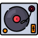

  

     

# noiseBMS

## Présentation
noiseBMS est un jeu de rythme libre inspiré par IIDX. Ce projet utilise le moteur de jeu Godot Engine 4.

Le jeu est en cours de développement.

## Jouer au jeu
[Jouer sur navigateur](https://djalexkidd.github.io/noisebms)

[Télécharger le jeu](https://github.com/djalexkidd/noisebms/releases)

## Fonctionnalités
- [x] Gameplay de base
- [x] Mutateurs de jeu et options d'assistance (HI-SPEED, RANDOM, AUTO-SCRATCH...)
- [x] Sauvegarde des scores
- [x] Multijoueur local (avec le mode BATTLE)
- [x] DOUBLE PLAY (14 touches sur les deux platines) pour les modules Amiga et les BMS
- [x] Multijoueur en ligne
- [ ] Classements en ligne
- [ ] Éditeur de niveaux
- [ ] Téléchargement de contenu crée par la communauté
- [x] Lecture directe des beatmaps Quaver (.qua)
- [x] Lecture directe des BMS (.bms, .bme, .bml) et bmson avec keysounds (SP 5 et 7 touches, DP)
- [x] Modules Amiga jouables directement avec keysounds

## Bibliothèque musicale
La sélection conserve les métadonnées des beatmaps Quaver, des BMS et des modules Amiga dans `user://song_catalog.json`. Une analyse est lancée automatiquement si le cache est absent, vide ou invalide ; les ouvertures suivantes réutilisent cette liste.

Après avoir ajouté, modifié ou supprimé des musiques manuellement dans `user://songs`, utilisez **Refresh song list** dans le menu de téléchargement et d'importation. L'importation d'un ZIP ou le téléchargement d'un pack actualise automatiquement la liste.

## Crédits
Ce jeu contient du code source de ces projets :

[gd-rhythm](https://github.com/scenent/gd-rhythm)

[Websocket-Multiplayer-Demo-Godot-4.0](https://github.com/pleyland/Websocket-Multiplayer-Demo-Godot-4.0)
